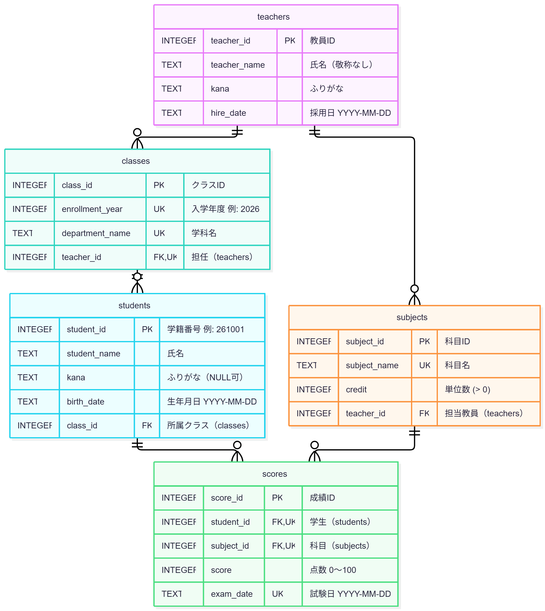

# データベース設計

## 主キーと外部キー

### 主キー（PRIMARY KEY）
- レコードを一意に識別する
- 重複した値を登録できない
- NULL（値なし）を登録できない
- 1つのテーブルに1つ設定できる（複数の列を組み合わせることもできる）

**一意とは**  = 同じ値が重複しない

### 外部キー（FOREIGN KEY）
- 他のテーブルの主キーなどを参照する
- テーブル同士の関連付けに使用する
- 参照先に存在しない値の登録を防ぐ（外部キー制約が有効な場合）
- NULLを許可するかどうかは設定による
- 1つのテーブルに複数設定できる

※ SQLiteは既定で外部キー制約チェックが無効になっている
`PRAGMA foreign_keys = ON;`

## ER図

### 1. ER図とは

**ER図（Entity Relationship Diagram）** は、データベースの**設計図**です。
「どんな表（テーブル）があって、表と表がどうつながっているか」を1枚の図で表します。

- システムを作るとき、どのようなデータをもつかを決定し、ER図を作成する
- Webサイトや業務システムの設計では、ほぼ必ず作られる、データベース設計の基本となる図

### 2. ER図を作っている4つの部品

| 部品 | 意味 | データベースでいうと |
| --- | --- | --- |
| **エンティティ** | データのまとまり（箱） | テーブル（例：`teachers`） |
| **アトリビュート** | エンティティが持つ項目 | 列（例：`teacher_name`） |
| **リレーションシップ** | エンティティ同士のつながり（線） | 外部キーによるつながり |
| **カーディナリティ** | 線の端に書く数字（多重度）。「1対多」など、何件と何件がつながるか | 1件に対して何件つながるか |

### 3. 多重度（カーディナリティ）の読み方

ER図で、テーブル同士の関係（1対1、1対多、多対多など）を表す方法には、複数の記法があります。
この授業では、線の両端に **数字** を書く記法を使います。

#### 3-1. 数字で書く記法（この授業で使う）

| 線の端に書く数字 | 意味 |
| --- | --- |
| `1` | ちょうど1件 |
| `0..1` | 0件か1件 |
| `1..*` | 1件以上（多） |
| `0..*` | 0件以上（多） |

`..` は「〜から〜まで」、`*` は「いくつでも」という意味です。

例：`teachers 1 ──── 0..* classes`

- ある1件のレコードから、相手側のレコードが何件関連付けられるかをみます。
  - `teachers` 側が `1` → クラス1つから見ると、担任の先生は**ちょうど1人**
  - `classes` 側が `0..*` → 先生1人から見ると、担任するクラスは**0個以上**（担任を持たない先生もいる）

**数字は「相手側の端」に書く** 点に注意します。
「先生1人から見たクラスの数」は、クラス側の端（`0..*`）を読みます。

=> 1対多の関係

#### 3-2. IE記法（参考）

- ER図で、テーブル同士の関係（1対1、1対多、多対多など）を表す方法には、複数の記法がある。
- その一つに、IE記法（Information Engineering記法） がある。
- IE記法では、線の端に「○」「｜」「鳥の足」のような記号を使って、関係の多重度を表す。

| 線の端の形 | Mermaidでの書き方 | 意味 |
| --- | --- | --- |
| 縦線2本 | `\|\|` | ちょうど1件 |
| ○と縦線 | `o\|` / `\|o` | 0件か1件 |
| ○と鳥の足 | `o{` / `}o` | 0件以上（多） |
| 縦線と鳥の足 | `\|{` / `}\|` | 1件以上（多） |

参考：https://qiita.com/ramuneru/items/32fbf3032b625f71b69d

---
