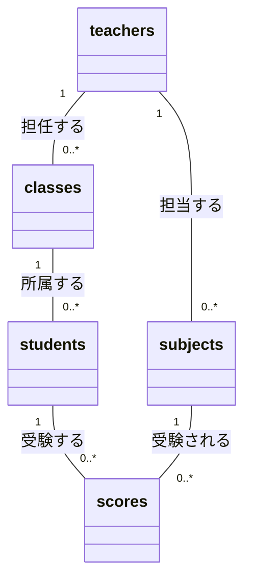
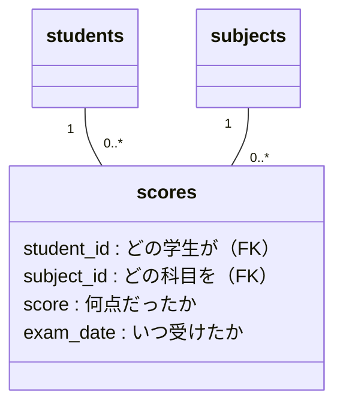

## ER図のリレーション

### 0.リレーションを描く

- **ヒント：同じ名前の列が、別のテーブルにも出てくるところを探そう**
- 線を引いたら、線の両端に多重度（`1`、`0..*` など）を書いてみよう

#### CREATE文で答え合わせ

`sql/00_create_and_seed.sql` の CREATE文で、ER図に関係するのは次の3つだけです。
（`CHECK` は「入力できる値のチェック」なので、ER図には出てきません）

| CREATE文の書き方 | ER図でわかること |
| --- | --- |
| `PRIMARY KEY` | 主キー（PK） |
| `FOREIGN KEY (列) REFERENCES 親テーブル(列)` | **線が引ける場所**。外部キーを持つ側が「多」、参照される側が「1」 |
| `NOT NULL`（外部キーの列に付いている） | 「1」側の端が **ちょうど1（`1`）** になる（`0..1` ではない） |

例：`classes` テーブル

```sql
CREATE TABLE classes (
    class_id        INTEGER PRIMARY KEY,    -- PK
    enrollment_year INTEGER NOT NULL ...,
    department_name TEXT NOT NULL,
    teacher_id      INTEGER NOT NULL,       -- NOT NULL → 担任は必ず1人
    FOREIGN KEY (teacher_id) REFERENCES teachers(teacher_id),  -- teachers との線
    UNIQUE (enrollment_year, department_name),
    UNIQUE (enrollment_year, teacher_id)
);
```

5つのテーブルの `FOREIGN KEY` を数えると **5つ** → 線も **5本** です。

### 1. 全体像



| つながり | 外部キー | 多重度 | 読み方 |
| --- | --- | --- | --- |
| `teachers` → `classes` | `classes.teacher_id` | 1 対 0以上 | 1人の先生は0個以上のクラスを担任する。クラスの担任はちょうど1人 |
| `teachers` → `subjects` | `subjects.teacher_id` | 1 対 0以上 | 1人の先生は0個以上の科目を担当する。科目の担当はちょうど1人 |
| `classes` → `students` | `students.class_id` | 1 対 0以上 | 1つのクラスに0人以上の学生が所属する。学生の所属クラスはちょうど1つ |
| `students` → `scores` | `scores.student_id` | 1 対 0以上 | 1人の学生は0件以上の成績を持つ |
| `subjects` → `scores` | `scores.subject_id` | 1 対 0以上 | 1つの科目は0件以上の成績を持つ |

**見分け方のコツ：外部キーを持っている側が「多」、参照される側が「1」**

- 外部キーは **1本ごとに、1本の線（リレーション）** を表す
  - `scores` のように1行に外部キーが2つ（`student_id`・`subject_id`）あれば、線も2本になる
- 1本の外部キーの列には1行に1つの値しか入らず、参照先は主キー（またはUNIQUE）なので、指す親の行は1つしかない → 子から見ると、**その線の先の** 親は「1つ」に決まる
- 親の同じ値を、子の何行からでも参照できる → 親から見ると子は「多」
- 外部キーに `NOT NULL` が付いている → 親側の端は「ちょうど1（`1`）」
  - NULLを許す外部キーなら、親側の端は「0か1（`0..1`）」になる


### 2. 各リレーションを実データで確認する

#### (1) teachers ─ classes（担任）

| teacher_id | teacher_name | 担任するクラス |
| --- | --- | --- |
| 1 | 佐藤美穂 | ITエンジニア学科 |
| 2 | 鈴木健一 | ITキャリア養成科 |
| … | … | … |
| 7 | 山本加奈 | 介護福祉学科 |
| 8 | 森隆 | **なし** |
| 9 | 岡田恵 | **なし** |

- 森先生・岡田先生は担任を持たない → 「多」の側が **0件もありえる（`0..*`）**
- `UNIQUE (enrollment_year, teacher_id)` により、**同じ入学年度** では1人1クラスまで。
  年度が違えば複数のクラスを担任できるので、ER図上は「1対多」のまま

#### (2) teachers ─ subjects（科目担当）

| subject_id | subject_name | teacher_id | 担当 |
| --- | --- | --- | --- |
| 1 | プログラミング | 1 | 佐藤美穂 |
| 2 | データベース | **8** | **森隆** |
| 3 | ネットワーク基礎 | **8** | **森隆** |
| 4 | 情報セキュリティ | 2 | 鈴木健一 |
| 5 | ビジネスマナー | 9 | 岡田恵 |

- 森先生は2科目を担当 → **1対多** の「多」の例
- 高橋先生（3）〜山本先生（7）は科目を担当していない → 0件の例

> `teachers` と `classes`、`teachers` と `subjects` は、**同じ `teachers` に2本の線** がつながっています。
> 「担任」と「科目担当」は別の意味のつながりなので、線も別々になります。

#### (3) classes ─ students（所属）

| class_id | department_name | 学生数 |
| --- | --- | --- |
| 1 | ITエンジニア学科 | 20 |
| 2〜7 | その他の学科 | 0 |

#### (4)(5) students ─ scores ─ subjects（成績）

- 学生1人あたりの成績：5件（261010 坂本優花さんだけ4件。ビジネスマナー未受験）
- 科目1つあたりの成績：20件（ビジネスマナーだけ19件）
- 成績は全部で **99件**

### 3. 多対多と中間テーブル

学生と科目の関係は、

- 1人の学生は **複数の科目** を受ける
- 1つの科目は **複数の学生** が受ける

という **多対多** です。リレーショナルデータベースでは多対多を直接つなげないため、
間に **中間テーブル `scores`** を置いて、「1対多」2本に分解しています。



中間テーブルは「つなぐだけ」ではなく、**その組み合わせにだけ存在する情報**（点数・試験日）を置く場所にもなります。
点数は「学生」だけでも「科目」だけでも決まらず、「誰が × どの科目を」で初めて決まるからです。
これは後で説明する **第2正規形** の考え方そのものです。

### 4. SQLで確かめる

```sql
-- 担任を持たない先生（teachers → classes が0件）
SELECT t.teacher_id, t.teacher_name
FROM teachers AS t
LEFT JOIN classes AS c ON c.teacher_id = t.teacher_id
WHERE c.class_id IS NULL;

-- 先生ごとの担当科目数（1対多の「多」を数える）
SELECT t.teacher_name, COUNT(s.subject_id) AS 担当科目数
FROM teachers AS t
LEFT JOIN subjects AS s ON s.teacher_id = t.teacher_id
GROUP BY t.teacher_id
ORDER BY 担当科目数 DESC;

-- 多対多：学生 × 科目 を中間テーブル経由でつなぐ
SELECT st.student_name, sb.subject_name, sc.score
FROM students AS st
JOIN scores   AS sc ON sc.student_id = st.student_id
JOIN subjects AS sb ON sb.subject_id = sc.subject_id
WHERE st.student_id = 261001;
```

---


## リレーションの説明

### 1. teachers ─ classes（担任する）

| 見る方向 | 言い方 | 多重度 | 根拠 |
| --- | --- | --- | --- |
| クラスから見る | **クラスには、担任の先生が必ず1人いる** | `1`（teachers 側の端） | `classes.teacher_id` は `NOT NULL` の外部キーで、1つの値しか入らない |
| 先生から見る | **先生は、クラスの担任を0個以上受け持つ**（受け持たない先生もいる） | `0..*`（classes 側の端） | 森先生・岡田先生は0個。年度が違えば複数受け持てる |

```
teachers 1 ──────── 0..* classes
```

- 同じ入学年度の中だけで見れば、`UNIQUE (enrollment_year, teacher_id)` があるので担任は1人1クラスまで
- ただし年度をまたぐと複数のクラスを担任できるので、ER図では `0..*` になる

### 2. teachers ─ subjects（担当する）

| 見る方向 | 言い方 | 多重度 | 根拠 |
| --- | --- | --- | --- |
| 科目から見る | **科目には、担当の先生が必ず1人いる** | `1`（teachers 側の端） | `subjects.teacher_id` は `NOT NULL` の外部キーで、1つの値しか入らない |
| 先生から見る | **先生は、科目を0個以上担当する**（担当しない先生もいる） | `0..*`（subjects 側の端） | 森先生は2科目（データベース・ネットワーク基礎）。高橋先生〜山本先生は0科目 |

```
teachers 1 ──────── 0..* subjects
```

- 「担任」と「科目担当」は別の意味のつながりなので、`teachers` から線が2本出る

### 3. classes ─ students（所属する）

| 見る方向 | 言い方 | 多重度 | 根拠 |
| --- | --- | --- | --- |
| 学生から見る | **学生は、必ず1つのクラスに所属する** | `1`（classes 側の端） | `students.class_id` は `NOT NULL` の外部キーで、1つの値しか入らない |
| クラスから見る | **クラスには、学生が0人以上いる**（学生がいないクラスもある） | `0..*`（students 側の端） | ITエンジニア学科は20人。ほかの6クラスは0人 |

```
classes 1 ──────── 0..* students
```

### 4. students ─ scores（受験する）

| 見る方向 | 言い方 | 多重度 | 根拠 |
| --- | --- | --- | --- |
| 成績から見る | **成績1件は、必ず1人の学生のもの** | `1`（students 側の端） | `scores.student_id` は `NOT NULL` の外部キーで、1つの値しか入らない |
| 学生から見る | **学生は、成績を0件以上持つ** | `0..*`（scores 側の端） | ほとんどの学生は5件。坂本さんは4件（ビジネスマナー未受験）。入学したばかりなら0件 |

```
students 1 ──────── 0..* scores
```

- 成績の件数は科目数と同じとは限らない。`UNIQUE (student_id, subject_id, exam_date)` なので、試験日が違えば同じ科目の成績（再試験）も登録できる

### 5. subjects ─ scores（受験される）

| 見る方向 | 言い方 | 多重度 | 根拠 |
| --- | --- | --- | --- |
| 成績から見る | **成績1件は、必ず1つの科目のもの** | `1`（subjects 側の端） | `scores.subject_id` は `NOT NULL` の外部キーで、1つの値しか入らない |
| 科目から見る | **科目には、成績が0件以上ある** | `0..*`（scores 側の端） | ほとんどの科目は20件。ビジネスマナーは19件。新しく開講した科目は0件 |

```
subjects 1 ──────── 0..* scores
```

### 6. students ─ subjects（多対多）

| 見る方向 | 言い方 | 多重度 |
| --- | --- | --- |
| 学生から見る | **学生は、複数の科目を受ける** | 多 |
| 科目から見る | **科目は、複数の学生が受ける** | 多 |

```
students 1 ── 0..* scores 0..* ── 1 subjects
```

- 多対多は直接つなげないので、中間テーブル `scores` を置いて「1対多」2本に分ける
- 成績表の1行は、学生と科目の **ペア1組**。ペアをたくさん作ることで、多対多を表している

### 共通の見分け方

- **外部キーを持っている側が「多」（`0..*`）、参照される側が「1」**
- 外部キーに `NOT NULL` が付いているので、「1」側は `0..1` ではなく `1`
- 多重度の数字は、**相手側の端** に書く（「先生1人から見たクラスの数」は、クラス側の端を読む）

番号1〜5はER図の線5本です。6は、scores を経由したまとめとして付けました。