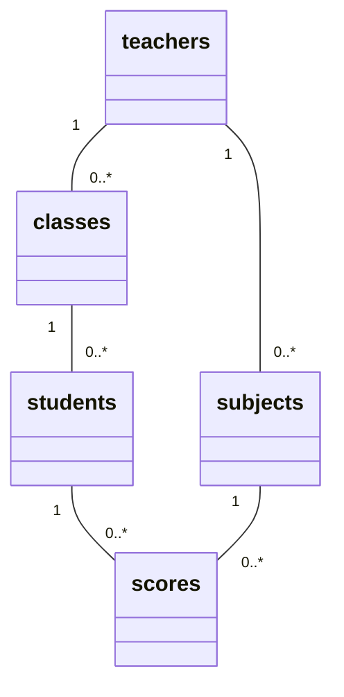

## 第2部　正規化

### 1. 問いかけ：1枚の表ではダメなの？

第1部で描いたER図の5つの表を、JOINで **1枚の表** にしてみます。DB Browser で実行してください。

```sql
-- 5つの表をJOINして、「1枚の表」を作る
SELECT
    st.student_id      AS 学籍番号,
    st.student_name    AS 氏名,
    st.kana            AS ふりがな,
    st.birth_date      AS 生年月日,
    c.enrollment_year  AS 入学年度,
    c.department_name  AS 学科名,
    c.teacher_id       AS 担任ID,
    ht.teacher_name    AS 担任名,
    sb.subject_id      AS 科目ID,
    sb.subject_name    AS 科目名,
    sb.credit          AS 単位数,
    sb.teacher_id      AS 担当教員ID,
    tt.teacher_name    AS 担当教員名,
    sc.score           AS 点数,
    sc.exam_date       AS 試験日
FROM scores AS sc
JOIN students AS st ON st.student_id = sc.student_id
JOIN classes  AS c  ON c.class_id    = st.class_id
JOIN teachers AS ht ON ht.teacher_id = c.teacher_id    -- 担任
JOIN subjects AS sb ON sb.subject_id = sc.subject_id
JOIN teachers AS tt ON tt.teacher_id = sb.teacher_id   -- 科目の担当
ORDER BY st.student_id, sb.subject_id;
```

結果は **99行**（成績の件数と同じ）。先頭はこうなります。

| 学籍番号 | 氏名 | ふりがな | 生年月日 | 入学年度 | 学科名 | 担任ID | 担任名 | 科目ID | 科目名 | 単位数 | 担当教員ID | 担当教員名 | 点数 | 試験日 |
| --- | --- | --- | --- | --- | --- | --- | --- | --- | --- | --- | --- | --- | --- | --- |
| 261001 | 青木翔 | あおきしょう | 2007-05-12 | 2026 | ITエンジニア学科 | 1 | 佐藤美穂 | 1 | プログラミング | 4 | 1 | 佐藤美穂 | 66 | 2026-07-13 |
| 261001 | 青木翔 | あおきしょう | 2007-05-12 | 2026 | ITエンジニア学科 | 1 | 佐藤美穂 | 2 | データベース | 3 | 8 | 森隆 | 73 | 2026-07-14 |
| 261001 | 青木翔 | あおきしょう | 2007-05-12 | 2026 | ITエンジニア学科 | 1 | 佐藤美穂 | 3 | ネットワーク基礎 | 3 | 8 | 森隆 | 79 | 2026-07-15 |
| 261001 | 青木翔 | あおきしょう | 2007-05-12 | 2026 | ITエンジニア学科 | 1 | 佐藤美穂 | 4 | 情報セキュリティ | 2 | 2 | 鈴木健一 | 79 | 2026-07-16 |
| 261001 | 青木翔 | あおきしょう | 2007-05-12 | 2026 | ITエンジニア学科 | 1 | 佐藤美穂 | 5 | ビジネスマナー | 2 | 9 | 岡田恵 | 66 | 2026-07-17 |
| 261002 | 石川葵 | いしかわあおい | 2007-07-23 | 2026 | ITエンジニア学科 | 1 | 佐藤美穂 | 1 | プログラミング | 4 | 1 | 佐藤美穂 | 89 | 2026-07-13 |
| … | … | … | … | … | … | … | … | … | … | … | … | … | … | … |

- `teachers` を **2回** JOINしている点に注目（担任として1回、科目担当として1回）
- Excelで成績を管理するなら、この1枚のシートで済ませそうです

**では、なぜデータベースでは、わざわざ5つに分けて保存しているのでしょうか？**

### 2. 1枚の表で困ること

上の表をよく見ると、**同じ情報が何度も出てきます**。

| 重複している情報 | 重複回数 |
| --- | --- |
| 青木さんの氏名・ふりがな・生年月日・学科・担任 | 5行 |
| 「データベース」の単位数・担当教員 | 20行 |
| 森先生の名前 | 40行（データベース20行＋ネットワーク基礎20行） |
| 佐藤先生の名前 | 「担任名」列に99行、「担当教員名」列に20行（プログラミング） |

同じ情報があちこちにあると、次の3つの問題が起こります。これをまとめて **更新時異常（アノマリー）** といいます。

| 異常 | 内容 |
| --- | --- |
| 更新異常 | 同じ情報が何か所にもあり、一部だけ直すと矛盾する |
| 挿入異常 | ある情報を登録したいのに、別の情報がそろわないと登録できない |
| 削除異常 | ある行を消すと、消したくない情報まで一緒に消える |

学生管理システムでは、具体的にこうなります。

| 異常 | 学生管理システムでの具体例 |
| --- | --- |
| 更新異常 | 森先生の名前の表記を変えるとき、40行を全部直さないといけない。1行でも直し忘れると「同じ先生なのに名前が2種類」になる |
| 挿入異常 | ITキャリア養成科（担任：鈴木先生）のクラスを作りたいが、まだ学生も成績もないので **行を作れない**（主キーの学籍番号・科目IDが空になってしまう） |
| 挿入異常 | 新しい科目を開講したいが、まだ誰も受験していないので登録できない |
| 削除異常 | ビジネスマナーの成績19行を「採点ミスのため一度削除」すると、**岡田先生がこの学校にいるという情報も消える**（岡田先生はこの行にしか出てこない） |

これを解決するために表を分けていく手順が **正規化** です。

> **正規化** とは、**同じ情報が何度も出てこないように、表を分けていく手順** です。

正規化は、段階的に進めます。

```
非正規形 ──(繰り返しをなくす)──> 第1正規形
         ──(部分関数従属をなくす)──> 第2正規形
         ──(推移的関数従属をなくす)──> 第3正規形
```

### 3. 関数従属（正規化を理解するためのキーワード）

**「A が決まれば B が1つに決まる」** とき、**B は A に関数従属する** といい、`A → B` と書きます。

| 関数従属 | 意味 |
| --- | --- |
| 学籍番号 → 氏名 | 学籍番号 261001 なら、氏名は「青木翔」に決まる |
| 科目ID → 単位数 | 科目ID 1（プログラミング）なら、単位数は 4 に決まる |
| (学籍番号, 科目ID, 試験日) → 点数 | 「誰が・どの科目を・いつ受けたか」が決まれば、点数が決まる |
| 学籍番号 → 点数 | **成り立たない**（青木さんの点数は科目ごとに違う） |

### 4. 非正規形と第1正規形（1NF）

#### 非正規形

実は、Excelで手作りすると、さらにこう書いてしまいがちです（一部の学生のみ表示）。

| 学籍番号 | 氏名 | ふりがな | 生年月日 | 入学年度 | 学科名 | 担任ID | 担任名 | 科目ID | 科目名 | 単位数 | 担当教員ID | 担当教員名 | 点数 | 試験日 |
| --- | --- | --- | --- | --- | --- | --- | --- | --- | --- | --- | --- | --- | --- | --- |
| 261001 | 青木翔 | あおきしょう | 2007-05-12 | 2026 | ITエンジニア学科 | 1 | 佐藤美穂 | 1<br>2<br>3<br>4<br>5 | プログラミング<br>データベース<br>ネットワーク基礎<br>情報セキュリティ<br>ビジネスマナー | 4<br>3<br>3<br>2<br>2 | 1<br>8<br>8<br>2<br>9 | 佐藤美穂<br>森隆<br>森隆<br>鈴木健一<br>岡田恵 | 66<br>73<br>79<br>79<br>66 | 2026-07-13<br>2026-07-14<br>2026-07-15<br>2026-07-16<br>2026-07-17 |
| 261010 | 坂本優花 | さかもとゆうか | 2008-03-27 | 2026 | ITエンジニア学科 | 1 | 佐藤美穂 | 1<br>2<br>3<br>4 | プログラミング<br>データベース<br>ネットワーク基礎<br>情報セキュリティ | 4<br>3<br>3<br>2 | 1<br>8<br>8<br>2 | 佐藤美穂<br>森隆<br>森隆<br>鈴木健一 | 62<br>51<br>61<br>67 | 2026-07-13<br>2026-07-14<br>2026-07-15<br>2026-07-16 |

**非正規形の特徴**：1つのセルに複数の値が入っている（**繰り返し項目** がある）。

- 「点数が80点以上の科目」を探すには、セルの中身を分解しないといけない
- 坂本さんは科目が4つ、青木さんは5つ…と、行ごとに中身の数がばらばら
- データベースの表は「1つのセルに1つの値」が前提なので、このままでは扱えない

#### 第1正規形：繰り返しをなくす

**ルール：1つのセルには1つの値だけを入れる。繰り返し項目は行に展開する。**

繰り返していた「科目〜試験日」を **1科目＝1行** に展開すると、**1で JOIN して作った99行の表** になります。
つまり、1の表は第1正規形です。

- 全部で **99行**（成績の件数と同じ）
- 1行を特定する主キーは **(学籍番号, 科目ID, 試験日)** の組み合わせ
  - 学籍番号だけでは5行あるので決まらない。科目IDだけでも20行ある
  - 試験日を含めるのは、同じ科目を再試験で受け直すことを想定しているため

第1正規形で表としては扱えるようになりましたが、**2で見た重複と異常はまだ残っています**。
ここから第2・第3正規形で解決していきます。

### 5. 第2正規形（2NF）：部分関数従属をなくす

**ルール：第1正規形であり、かつ、主キーの「一部だけ」で決まる列をなくす。**

主キー (学籍番号, 科目ID, 試験日) の各列が、何を決めているかを調べます。

```
学籍番号 だけで決まる    → 氏名, ふりがな, 生年月日, 入学年度, 学科名, 担任ID, 担任名
科目ID   だけで決まる    → 科目名, 単位数, 担当教員ID, 担当教員名
(学籍番号, 科目ID, 試験日) 全部で決まる → 点数
```

主キーの **一部（学籍番号だけ・科目IDだけ）** で決まってしまう列があります。これを **部分関数従属** といいます。
主キーの一部で決まる列は、その一部を主キーにした **別の表に切り出します**。

**学生表**（主キー：学籍番号） … 20行

| 学籍番号 | 氏名 | ふりがな | 生年月日 | 入学年度 | 学科名 | 担任ID | 担任名 |
| --- | --- | --- | --- | --- | --- | --- | --- |
| 261001 | 青木翔 | あおきしょう | 2007-05-12 | 2026 | ITエンジニア学科 | 1 | 佐藤美穂 |
| 261002 | 石川葵 | いしかわあおい | 2007-07-23 | 2026 | ITエンジニア学科 | 1 | 佐藤美穂 |
| … | … | … | … | … | … | … | … |

**科目表**（主キー：科目ID） … 5行

| 科目ID | 科目名 | 単位数 | 担当教員ID | 担当教員名 |
| --- | --- | --- | --- | --- |
| 1 | プログラミング | 4 | 1 | 佐藤美穂 |
| 2 | データベース | 3 | 8 | 森隆 |
| 3 | ネットワーク基礎 | 3 | 8 | 森隆 |
| 4 | 情報セキュリティ | 2 | 2 | 鈴木健一 |
| 5 | ビジネスマナー | 2 | 9 | 岡田恵 |

**成績表**（主キー：学籍番号, 科目ID, 試験日） … 99行

| 学籍番号 | 科目ID | 試験日 | 点数 |
| --- | --- | --- | --- |
| 261001 | 1 | 2026-07-13 | 66 |
| 261001 | 2 | 2026-07-14 | 73 |
| … | … | … | … |

#### 第2正規形で解決したこと

- 「データベース」の単位数は、科目表の **1か所だけ** に書かれるようになった
- 誰も受験していない新しい科目も、科目表に登録できるようになった
- 成績表には「学籍番号・科目ID・試験日・点数」だけが残り、**第1部で見た中間テーブル `scores` の形** になった

#### まだ残っている問題

| 異常 | 具体例 |
| --- | --- |
| 更新異常 | 学生表で「佐藤美穂」が20行に重複している。科目表でも「森隆」が2行に重複している |
| 挿入異常 | 学生のいないクラス（ITキャリア養成科・担任 鈴木先生）は、学生表に行を作れないので登録できない |
| 挿入異常 | 担任も科目も持たない先生は、どの表にも登録できない |
| 削除異常 | ITエンジニア学科の学生が全員卒業して学生表から消えると、「ITエンジニア学科の担任は佐藤先生」という情報も消える |

### 6. 第3正規形（3NF）：推移的関数従属をなくす

**ルール：第2正規形であり、かつ、主キー以外の列によって決まる列をなくす。**

学生表の中の従属関係をよく見ると、次のような **2段階の決まり方** になっています。

```
学籍番号 → (入学年度, 学科名) → 担任ID → 担任名
           ↑ どのクラスか         ↑ そのクラスの担任   ↑ その先生の名前
```

- 担任名は、本当は **学籍番号ではなく「担任ID」で決まる**
- 担任IDは、本当は **学籍番号ではなく「どのクラスか」で決まる**

このように、**主キー → 主キー以外の列 → 別の列** と、間接的に決まることを **推移的関数従属** といいます。
科目表にも同じ形があります。

```
科目ID → 担当教員ID → 担当教員名
```

推移的に決まっている部分を、**途中の列を主キーにした別の表** に切り出します。

#### (1) 教員の情報を切り出す → `teachers`

`担任ID → 担任名`、`担当教員ID → 担当教員名` は、どちらも「教員ID → 教員の名前」です。
担任も科目担当も同じ教員なので、**1つの表にまとめます**。

| teacher_id | teacher_name | kana | hire_date |
| --- | --- | --- | --- |
| 1 | 佐藤美穂 | さとうみほ | 2012-04-01 |
| 2 | 鈴木健一 | すずきけんいち | 2015-04-01 |
| … | … | … | … |
| 8 | 森隆 | もりたかし | 2020-04-01 |
| 9 | 岡田恵 | おかだめぐみ | 2023-04-01 |

学生表・科目表には **teacher_id（外部キー）だけを残し**、名前は持たせません。

#### (2) クラスの情報を切り出す → `classes`

`(入学年度, 学科名) → 担任ID` は「クラス → 担任」です。クラスを独立した表にし、
扱いやすいように **class_id**（代理キー）を主キーにします。

| class_id | enrollment_year | department_name | teacher_id |
| --- | --- | --- | --- |
| 1 | 2026 | ITエンジニア学科 | 1 |
| 2 | 2026 | ITキャリア養成科 | 2 |
| … | … | … | … |

- 本来のキーだった (入学年度, 学科名) には `UNIQUE` を付けて、重複を防いでいる
- 学生表には **class_id（外部キー）だけを残す**

#### (3) 第3正規形の完成形 = 今のテーブル構成

| テーブル | 主キー | 残った列 | 外部キー |
| --- | --- | --- | --- |
| `teachers` | teacher_id | teacher_name, kana, hire_date | なし |
| `classes` | class_id | enrollment_year, department_name | teacher_id |
| `students` | student_id | student_name, kana, birth_date | class_id |
| `subjects` | subject_id | subject_name, credit | teacher_id |
| `scores` | score_id | score, exam_date | student_id, subject_id |



**正規化を進めた結果が、そのまま第1部のER図になっています。**
切り出した表と元の表をつなぐために残した列が **外部キー** であり、ER図の **線** になります。

#### 第3正規形で解決したこと

| 以前の問題 | 第3正規形では |
| --- | --- |
| 森先生の名前が40行（2NFでも2行）に重複 | `teachers` の **1行だけ** を直せばよい |
| 学生のいないクラスを登録できない | `classes` に登録できる（class_id 2〜7 がまさにその例） |
| 担任も科目も持たない先生を登録できない | `teachers` に登録できる |
| 学生を消すと担任の情報も消える | クラスと担任の情報は `classes` に残る |
| ビジネスマナーの成績を消すと岡田先生の情報も消える | 岡田先生は `teachers` に、科目は `subjects` に残る |

### 7. 補足

#### scores の主キーについて

正規化の手順では、成績表の主キーは (学籍番号, 科目ID, 試験日) でした。
実際の `scores` では、扱いやすさのために **score_id（代理キー）** を主キーにし、
本来のキーには `UNIQUE (student_id, subject_id, exam_date)` を付けて重複を防いでいます。
「主キーは1列の連番、本来のキーは一意制約で守る」という形は、実務でもよく使われます。

#### 分けて保存し、JOINで見る

正規化で表を分けても、情報は失われていません。1のように JOIN すれば、いつでも1枚の表に戻せます。
**「保存するときは分けて重複をなくし、見るときはJOINでくっつける」** のがリレーショナルデータベースの基本です。

### 8. まとめ

| 正規形 | ルール | 学生管理システムでやったこと |
| --- | --- | --- |
| 第1正規形 | 1つのセルに1つの値。繰り返し項目をなくす | 科目ごとの成績を1行ずつに展開した |
| 第2正規形 | 主キーの一部だけで決まる列をなくす（部分関数従属の排除） | 学生の情報・科目の情報を、成績から切り出した |
| 第3正規形 | 主キー以外の列で決まる列をなくす（推移的関数従属の排除） | 教員の情報・クラスの情報を切り出した |

覚え方：**「すべての列は、キーに、キー全体に、キー以外の何物でもなく従属する」**

- 第1正規形 … **キーに** 従属する（1行が1つのキーで特定できる）
- 第2正規形 … **キー全体に** 従属する（キーの一部ではない）
- 第3正規形 … **キー以外の何物でもなく** 従属する（ほかの列を経由しない）
