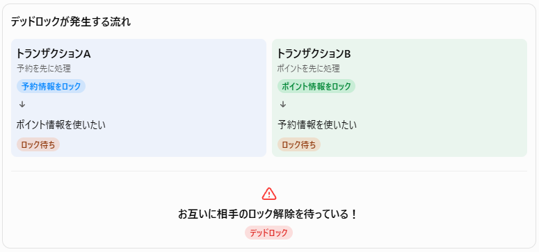

## データベースのトランザクションと排他制御

## 1. ホテル予約サイトで考えてみよう

あなたは旅行のためにホテルを予約しようとしています。

宿泊したいホテルを見つけ、予約ボタンを押しました。

ところが、そのホテルの空室は残り1部屋。ほぼ同時に、別の人も予約ボタンを押しました。


ここで、次のような問題が起きたらどうなるでしょうか？

- 2人が同じ1部屋を予約してしまったら？
- 予約情報は登録されたのに、空室数が更新されなかったら？
- 予約処理の途中でサーバーが故障したら？

---

ホテルの予約サイトでは、このような問題を防ぐためにデータベースのさまざまな仕組みが使われています。

---

## 2. トランザクションとは？

**トランザクションとは、複数のデータベース処理をひとまとまりとして扱う単位のこと。**

ホテルの予約では、例えば次のような処理を行います。

1. 空室があるか確認する
2. 空室数を1減らす
3. 予約者の情報を登録する
4. 予約番号を発行する

これらは、すべて予約を成立させるための一連の処理です。

途中で一部だけ成功してしまうと、データに矛盾が生じる可能性があります。

そのため、トランザクションとしてまとめて管理します。

## 3. COMMIT（コミット）とROLLBACK（ロールバック）

トランザクションには、重要な2つの操作があります。

**① COMMIT（コミット）**

トランザクション内の処理がすべて正常に完了したとき、その変更を確定させること。

例：空室数の更新、予約情報の登録が成功したので、予約を正式に成立させる。

**② ROLLBACK（ロールバック）**

トランザクション内の処理でエラーが発生したとき、変更を取り消して、処理開始前の状態に戻すこと。

例：空室数を減らした後、予約情報の登録に失敗したので、空室数を元に戻す。

| 操作 | 意味 | ホテル予約の例 |
|---|---|---|
| COMMIT | 変更を確定する | 予約成立 |
| ROLLBACK | 変更を取り消す | 予約処理を取り消す |

**イメージ：**

- COMMIT：これで決定！
- ROLLBACK：やっぱり取り消し！

※一度COMMITした変更は、通常のROLLBACKでは取り消せません。予約後にキャンセルする場合は、別のキャンセル処理を実行します。

**SQLでの例**

```sql
BEGIN TRANSACTION;

-- 空室数を1減らす
UPDATE rooms
SET vacant_count = vacant_count - 1
WHERE room_id = 101;

-- 予約情報を登録する
INSERT INTO reservations (customer_id, room_id)
VALUES (1, 101);

-- すべて成功したので確定
COMMIT;
```

- MySQLでは、`START TRANSACTION;` 

途中でエラーが発生した場合は、次のようにします。

```sql
ROLLBACK;
```

### やってみよう：todo.db でCOMMITとROLLBACKを試す

`todo.db` の `tasks` テーブルを使って、実際にCOMMITとROLLBACKを試してみましょう。

**準備：今の状態を確認する**

```sql
SELECT id, title, completed FROM tasks WHERE id IN (1, 2);
```

- IN は 「指定した値のいずれかに一致する」 という意味

`completed` の値（0：未完了、1：完了）をメモしておきます。

**実験①：ROLLBACK（取り消し）**

```sql
BEGIN TRANSACTION;

-- タスク1を「完了」にする
UPDATE tasks SET completed = 1 WHERE id = 1;

-- トランザクションの中では、変更されて見える
SELECT id, title, completed FROM tasks WHERE id = 1;
```

```sql
-- やっぱり取り消し！
ROLLBACK;

-- 元の値に戻っていることを確認
SELECT id, title, completed FROM tasks WHERE id = 1;
```

**実験②：COMMIT（確定）**

```sql
BEGIN TRANSACTION;

UPDATE tasks SET completed = 1 WHERE id = 1;

-- これで決定！
COMMIT;

SELECT id, title, completed FROM tasks WHERE id = 1;
```


---

## 4. ACID特性とは？

トランザクションには、信頼性を保つための4つの重要な性質があります。

これを **ACID（アシッド）特性** といいます。

| 特性 | 英語 | 意味 | ホテル予約での例 |
|---|---|---|---|
| A | Atomicity（原子性） | 全部成功するか、全部失敗する | 空室数だけ減るような中途半端な状態にしない |
| C | Consistency（一貫性） | データの整合性を保つ | 空室数がマイナスにならない |
| I | Isolation（独立性） | 同時実行による干渉を防ぐ | AさんとBさんの予約処理が不適切に干渉しない |
| D | Durability（耐久性） | 確定したデータを失わない | 予約確定後にサーバーが故障しても予約データを回復できる|


---

## 5. 排他制御とロック

最初の話に戻ります。

ホテルの空室が残り1部屋のとき、AさんとBさんが同時に予約しようとしました。

**排他制御とは、複数の処理が同じデータを同時に更新して問題が起きないように制御すること。**

これを実現する代表的な方法が **ロック** です。

ロックとは、データに鍵をかけて、ほかの処理によるアクセスや更新を制限する仕組みです。


**ロックがない場合**

1. Aさんが空室を確認する → 1部屋ある
2. Bさんが空室を確認する → 1部屋ある
3. Aさんが予約する
4. Bさんも予約する

結果：1部屋しかないのに、2人とも予約できてしまう可能性がある。

**ロックがある場合**

1. Aさんが予約処理を開始し、対象データをロックする
2. Bさんが同じデータを更新しようとするが、待機する
3. Aさんが予約を確定（COMMIT）する
4. Aさんのロックが解除される
5. Bさんが処理を再開する
6. 空室がないことを確認し、予約できない

このように、ロックによって二重予約を防ぎます。

| 用語 | 意味 |
|---|---|
| 排他制御 | 同時アクセスによる問題を防ぐ考え方・仕組み |
| ロック | データへのアクセスや更新を制限する具体的な方法 |

### デッドロック（Deadlock）

複数のトランザクションがお互いに相手の処理が終わるのを待ち続け、処理が進まなくなってしまう状態のこと。

例：ホテルの部屋予約

ホテルに残り1室しか空いていない状況を考えます。
- トランザクションA：部屋を予約し、ポイントを使用する
- トランザクションB：ポイントを使用し、部屋を予約する
データベースには「予約情報」と「ポイント情報」があるとします。





---

