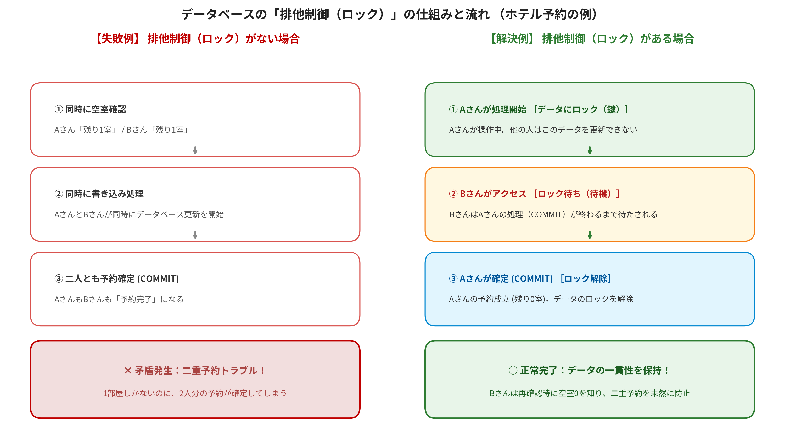

## データベースのトランザクションと排他制御

## 1. ホテル予約サイトで考えてみよう

あなたは旅行のためにホテルを予約しようとしています。

宿泊したいホテルを見つけ、予約ボタンを押しました。

ところが、そのホテルの空室は残り1部屋。ほぼ同時に、別の人も予約ボタンを押しました。


ここで、次のような問題が起きたらどうなるでしょうか？

- 2人が同じ1部屋を予約してしまったら？
- 予約情報は登録されたのに、空室数が更新されなかったら？
- 予約処理の途中でサーバーが故障したら？

ホテルの予約サイトでは、このような問題を防ぐためにデータベースのさまざまな仕組みが使われています。

---

## 2. トランザクションとは？

**トランザクションとは、複数のデータベース処理をひとまとまりとして扱う単位のこと。**

ホテルの予約では、例えば次のような処理を行います。

1. 空室があるか確認する
2. 空室数を1減らす
3. 予約者の情報を登録する
4. 予約番号を発行する

これらは、すべて予約を成立させるための一連の処理です。

途中で一部だけ成功してしまうと、データに矛盾が生じる可能性があります。

そのため、トランザクションとしてまとめて管理します。

## 3. COMMIT（コミット）とROLLBACK（ロールバック）

トランザクションには、重要な2つの操作があります。

**① COMMIT（コミット）**

トランザクション内の処理がすべて正常に完了したとき、その変更を確定させること。

例：空室数の更新、予約情報の登録が成功したので、予約を正式に成立させる。

**② ROLLBACK（ロールバック）**

トランザクション内の処理でエラーが発生したとき、変更を取り消して、処理開始前の状態に戻すこと。

例：空室数を減らした後、予約情報の登録に失敗したので、空室数を元に戻す。

| 操作 | 意味 | ホテル予約の例 |
|---|---|---|
| COMMIT | 変更を確定する | 予約成立 |
| ROLLBACK | 変更を取り消す | 予約処理を取り消す |

**イメージ：**

- COMMIT：これで決定！
- ROLLBACK：やっぱり取り消し！

※一度COMMITした変更は、通常のROLLBACKでは取り消せません。予約後にキャンセルする場合は、別のキャンセル処理を実行します。

**SQLでの例**

```sql
BEGIN TRANSACTION;

-- 空室数を1減らす
UPDATE rooms
SET vacant_count = vacant_count - 1
WHERE room_id = 101;

-- 予約情報を登録する
INSERT INTO reservations (customer_id, room_id)
VALUES (1, 101);

-- すべて成功したので確定
COMMIT;
```

途中でエラーが発生した場合は、次のようにします。

```sql
ROLLBACK;
```

### やってみよう：tasks.db でCOMMITとROLLBACKを試す

`tasks.db` の `tasks` テーブルを使って、実際にCOMMITとROLLBACKを試してみましょう。

DB Browser for SQLite で `tasks.db` を開き、「SQL実行」タブで1ブロックずつ実行します。

> **注意**
> - DB Browser では、データを変更しても、すぐにはファイル（`tasks.db`）に保存されません。「変更を書き込む」ボタン（`Ctrl + S`）を押したときに保存され、「変更を取り消し」ボタンを押すと元に戻ります。つまり DB Browser は、裏側で自動的にトランザクションを使っています（「変更を書き込む」＝COMMIT、「変更を取り消し」＝ROLLBACK のイメージ）。
> - そのため、自分で `BEGIN TRANSACTION;` を書くと、DB Browser の自動のトランザクションと重なってしまいます。実行したときに、まだ保存していない変更を先に保存するか確認する画面が出たら、「はい」を選んでください。
> - 始める前に「変更を書き込む」を押して、保存していない変更がない状態にしておくと安心です。
> - 例では `id = 1`, `id = 2` のタスクを使います。先に `SELECT * FROM tasks;` で、存在する id を確認し、必要に応じて書き換えてください。

**準備：今の状態を確認する**

```sql
SELECT id, title, completed FROM tasks WHERE id IN (1, 2);
```

`completed` の値（0：未完了、1：完了）をメモしておきます。

**実験①：ROLLBACK（取り消し）**

```sql
BEGIN TRANSACTION;

-- タスク1を「完了」にする
UPDATE tasks SET completed = 1 WHERE id = 1;

-- トランザクションの中では、変更されて見える
SELECT id, title, completed FROM tasks WHERE id = 1;
```

```sql
-- やっぱり取り消し！
ROLLBACK;

-- 元の値に戻っていることを確認
SELECT id, title, completed FROM tasks WHERE id = 1;
```

**実験②：COMMIT（確定）**

```sql
BEGIN TRANSACTION;

UPDATE tasks SET completed = 1 WHERE id = 1;

-- これで決定！
COMMIT;

SELECT id, title, completed FROM tasks WHERE id = 1;
```

COMMIT後は、`ROLLBACK;` を実行しても元に戻りません（試してみましょう）。
元に戻したい場合は、`UPDATE tasks SET completed = 0 WHERE id = 1;` のように、別の更新処理を実行します。

**実験③：途中でエラーが起きたら？（原子性）**

`tasks` テーブルには `CHECK (completed IN (0, 1))` という制約があるので、`completed` に 2 は入りません。これを使って、わざとエラーを起こします。

```sql
BEGIN TRANSACTION;

-- 1つ目：成功する
UPDATE tasks SET completed = 1 WHERE id = 1;

-- 2つ目：CHECK制約違反でエラーになる
UPDATE tasks SET completed = 2 WHERE id = 2;
```

エラーが表示されたら、次を実行します。

```sql
-- 途中で失敗したので、全部取り消す
ROLLBACK;

SELECT id, title, completed FROM tasks WHERE id IN (1, 2);
```

成功していた1つ目の更新も取り消され、どちらも元の状態に戻ります。
これが **「全部成功するか、全部失敗する」（原子性）** です。

※ SQLite では、エラーになったSQL文だけが取り消され、トランザクション自体は続いています。そのため、エラーが起きたら自分で `ROLLBACK;` を実行する必要があります。

---

## 4. ACID特性とは？

トランザクションには、信頼性を保つための4つの重要な性質があります。

これを **ACID（アシッド）特性** といいます。

| 特性 | 英語 | 意味 | ホテル予約での例 |
|---|---|---|---|
| A | Atomicity（原子性） | 全部成功するか、全部失敗する | 空室数だけ減るような中途半端な状態にしない |
| C | Consistency（一貫性） | データの整合性を保つ | 空室数がマイナスにならない |
| I | Isolation（独立性） | 同時実行による干渉を防ぐ | AさんとBさんの予約処理が不適切に干渉しない |
| D | Durability（永続性） | 確定したデータを失わない | 予約確定後にサーバーが故障しても予約データが残る |

覚え方：
- A：全部か、ゼロか
- C：矛盾しない
- I：お互いに邪魔しない
- D：確定したら消えない

---

## 5. 排他制御とロック

最初の話に戻ります。

ホテルの空室が残り1部屋のとき、AさんとBさんが同時に予約しようとしました。

**排他制御とは、複数の処理が同じデータを同時に更新して問題が起きないように制御すること。**

これを実現する代表的な方法が **ロック** です。

ロックとは、データに鍵をかけて、ほかの処理によるアクセスや更新を制限する仕組みです。



**ロックがない場合**

1. Aさんが空室を確認する → 1部屋ある
2. Bさんが空室を確認する → 1部屋ある
3. Aさんが予約する
4. Bさんも予約する

結果：1部屋しかないのに、2人とも予約できてしまう可能性がある。

**ロックがある場合**

1. Aさんが予約処理を開始し、対象データをロックする
2. Bさんが同じデータを更新しようとするが、待機する
3. Aさんが予約を確定（COMMIT）する
4. Aさんのロックが解除される
5. Bさんが処理を再開する
6. 空室がないことを確認し、予約できない

このように、ロックによって二重予約を防ぎます。

| 用語 | 意味 |
|---|---|
| 排他制御 | 同時アクセスによる問題を防ぐ考え方・仕組み |
| ロック | データへのアクセスや更新を制限する具体的な方法 |

---

## 6. ロールフォワードとは？

今度は、ホテルのデータベースサーバーが故障してしまったとします。

ホテルの予約情報を失わないためには、バックアップを使って復旧する必要があります。

**ロールフォワードとは、バックアップしたデータに、その後の更新ログを適用して、データベースを復旧する方法のこと。**

例えば、

1. 月曜日：データベースのバックアップを取得
2. 火曜日：Aさんがホテルを予約
3. 水曜日：Bさんがホテルを予約
4. 木曜日：サーバーが故障
5. バックアップに火曜日・水曜日の更新ログを適用

結果：故障前の予約データに復旧できる。

| 用語 | 意味 | イメージ |
|---|---|---|
| ロールバック | 未確定の処理を取り消す | 元に戻す |
| ロールフォワード | バックアップに更新ログを適用する | 先に進める |

---


### 今日のまとめ

| 用語 | 覚えておきたい意味 |
|---|---|
| トランザクション | 複数の処理をひとまとまりにする |
| COMMIT | 処理結果を確定する |
| ROLLBACK | 処理結果を取り消す |
| ACID | トランザクションの信頼性を保つ4つの性質 |
| 排他制御 | 同時アクセスによる問題を防ぐ |
| ロック | データへのアクセスを制限する |
| ロールフォワード | バックアップとログから復旧する |
| 二相コミットメント | 複数のシステムの処理を協調して確定・中止する |

