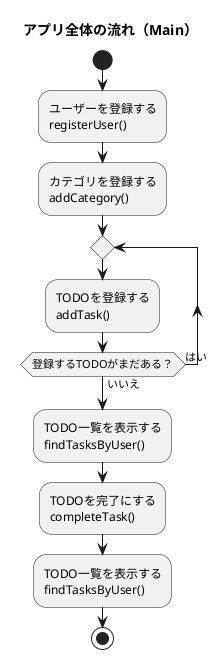
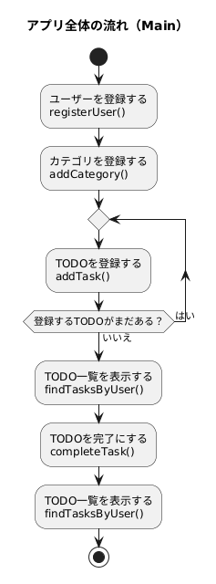

# TODOアプリのアクティビティ図

[クラス図](class_diagram.md)・[シーケンス図](sequence_diagram.md) と同じ [Javaプログラム](java/) をもとに、**処理の流れ（順番・分岐・くり返し）** をアクティビティ図で表します。

## 1. アプリ全体の流れ（Main）

`Main` を実行したときの処理の流れです。

---

## 3つの図の違い

| 図 | わかること |
| -- | ---------- |
| クラス図 | どんなクラスがあり、どんなデータとメソッドを持つか（**構造**） |
| シーケンス図 | どのオブジェクトが、どの順番でメソッドを呼ぶか（**オブジェクト間のやりとり**） |
| アクティビティ図 | どんな順番・条件・くり返しで処理が進むか（**処理の流れ**） |
