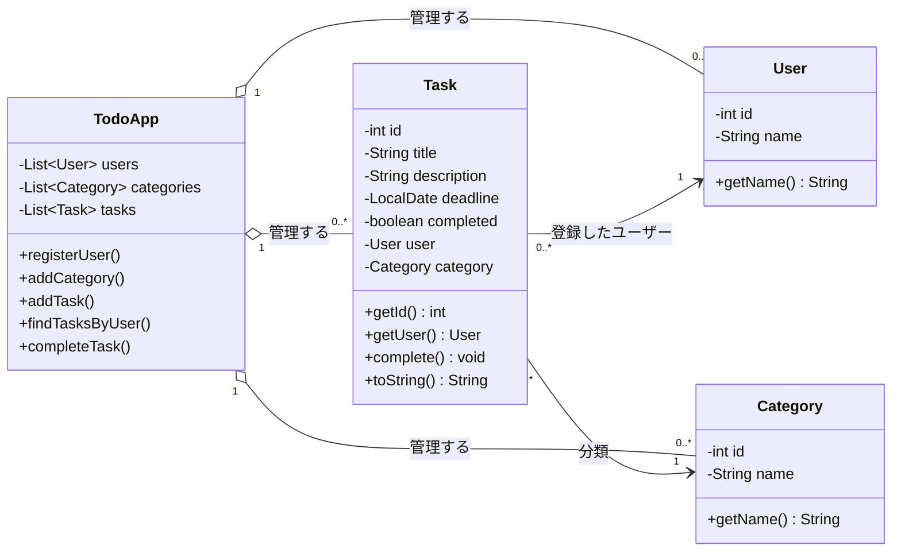

# TODOアプリのクラス図

[README](README.md) で設計したテーブル（`users`・`categories`・`tasks`）をもとに、TODOアプリをプログラム（Javaを想定）で作るときのクラス図を考えます。

---

## 1. クラス図

### 記号の読み方

| 記号 | 意味 |
| ---- | ---- |
| `-` | private（クラスの外から直接使えない） |
| `+` | public（クラスの外から使える） |
| `o--`（白いひし形） | 集約：`TodoApp` が `User`・`Category`・`Task` をまとめて持つ |
| `-->`（矢印） | 関連：`Task` が `User`・`Category` を参照する |
| `"1"`・`"0..*"` | 多重度（相手がいくつあるか） |

---

## 2. 機能とメソッドの対応

| No. | 機能           | メソッド                         | 対応するSQL |
| --- | -------------- | -------------------------------- | ----------- |
| 1   | ユーザー登録   | `TodoApp.registerUser()`         | `INSERT INTO users` |
| 2   | TODO登録       | `TodoApp.addTask()`              | `INSERT INTO tasks` |
| 3   | カテゴリ分類   | `TodoApp.addCategory()`          | `INSERT INTO categories` |
| 4   | TODO一覧       | `TodoApp.findTasksByUser()`      | `SELECT ... WHERE user_id = ?` |
| 5   | 完了状態の変更 | `TodoApp.completeTask()` → `Task.complete()` | `UPDATE tasks SET is_completed = 1` |

---

## 3. ER図とクラス図の違い

ER図（README の 3-2）とクラス図はよく似ていますが、表しているものが違います。

| 観点 | ER図（テーブル） | クラス図（プログラム） |
| ---- | ---------------- | ---------------------- |
| 表すもの | データの**保存のしかた** | データと**処理（メソッド）** |
| 他のデータとのつながり | 外部キー `user_id`（**番号**を持つ） | フィールド `User user`（**オブジェクト**を持つ） |

- 多重度（1 と 0..*）の考え方は、ER図とクラス図で共通です。
