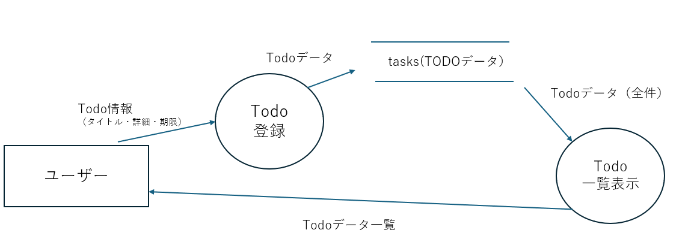

# TODOアプリのDFD（データフロー図）

## 例
TODOを登録して、登録したTODOを含めた一覧をユーザーに表示するシステムのDFD

## 1. DFDの記号

| 記号 | 名前 | 意味 | この図での描き方 |
| ---- | ---- | ---- | ---------------- |
| □ 四角 | **外部実体** | システムの外にいて、データを渡す・受け取る人や組織 | `[ユーザー]` |
| ○ 丸 | **プロセス** | データを受け取って、加工・変換する処理 | `((Todo登録))` |
| ＝ 二重線 | **データストア** | データを保存しておく場所（ファイル・テーブル） | `[(tasks)]` |
| → 矢印 | **データフロー** | データの流れ。矢印に **データの名前** を書く | `-->\|todo情報\|` |

## 2. DFDを描くときのルール

| ルール | 理由 | 
| ------ | ---- |
| データは **必ずプロセスを通る** | 外部実体やデータストアどうしを直接つなぐと、誰がデータを加工したかわからない |
| プロセスには **入力と出力の両方** がある | 入力しかない処理（ブラックホール）や、出力しかない処理（奇跡）はありえない | 
| 矢印には **データの名前** を書く | 何が流れているかわからないと、図の意味がない | 
| **処理の順番や条件は描かない** | 順番・くり返し・分岐はアクティビティ図の役割 | 

---

## 3. 他の図との違い

| 図 | 答えている質問 | 注目するもの |
| -- | -------------- | ------------ |
| ER図 | どんなデータを保存するか？ | データの **構造** と関係 |
| シーケンス図 | 部品どうしが、どの順番でやりとりするか？ | オブジェクト間の **呼び出し順** |
| アクティビティ図 | 処理はどんな手順・条件・くり返しで進むか？ | 処理の **手順と分岐** |
| **DFD** | **データはどこから来て、どこへ行くか？** | **データの流れ** |

