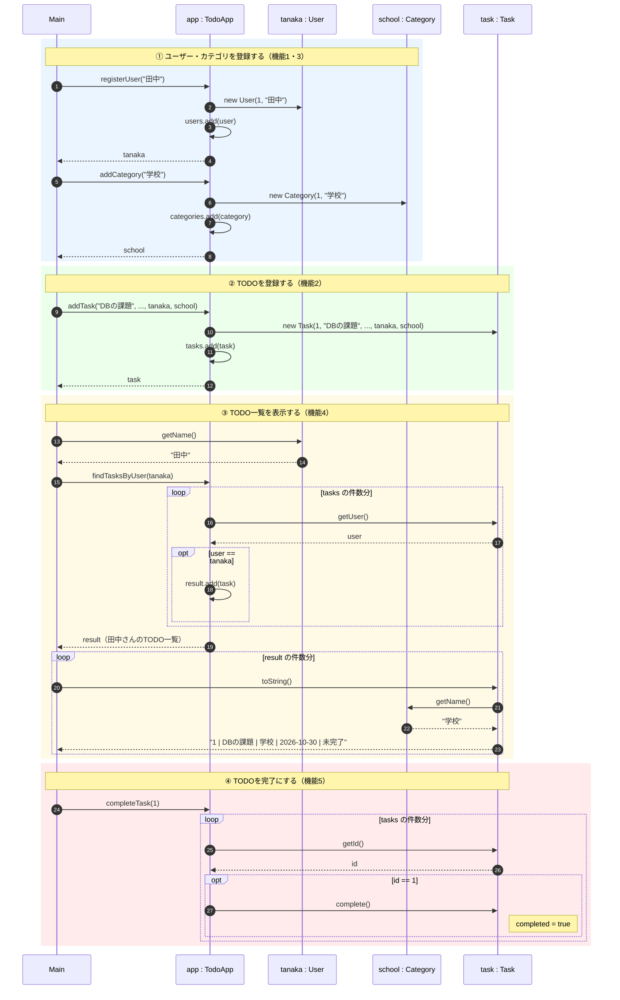

# TODOアプリのシーケンス図

[クラス図](class_diagram.md) と [Javaプログラム](java/) をもとに、`Main` を実行したときに **どのオブジェクトが、どの順番で、どのメソッドを呼び出すか** をシーケンス図で表します。

---

## 1. シーケンス図

> 図を見やすくするため、ユーザー・カテゴリ・TODOは1件ずつ（田中・学校・DBの課題）だけ登録しています。
> 実際の `Main` では、同じ流れを件数分くり返しています。

---

## 2. 記号の読み方

| 記号 | 意味 |
| ---- | ---- |
| `app : TodoApp` | 上の四角（ライフライン）。「オブジェクト名 : クラス名」 |
| 実線の矢印（`->>`） | メソッドの呼び出し（メッセージ） |
| 点線の矢印（`-->>`） | 呼び出し元への戻り値 |
| 自分自身への矢印 | 自分のフィールドを操作する（例：`users.add()`） |
| `loop` | くり返し（Javaの `for` 文） |
| `opt` | 条件を満たすときだけ実行（Javaの `if` 文） |
| 番号（1, 2, 3 …） | 処理が実行される順番 |

---

## 3. クラス図との違い

| 図 | わかること |
| -- | ---------- |
| クラス図 | どんなクラスがあり、どんなデータとメソッドを持つか（**構造**） |
| シーケンス図 | どのオブジェクトが、どの順番でメソッドを呼ぶか（**動き**） |

