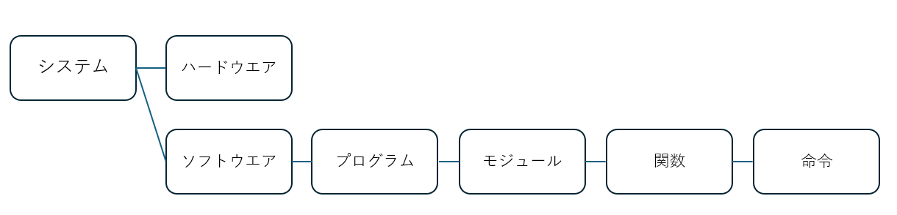

## モジュールとは

**モジュール**とは、プログラムを**機能ごとに分けた部品**のことです。



（例）モジュールの大きさは設計によって変わります。

| 1つの大きなプログラム | | モジュールに分けたプログラム |
| --- | --- | --- |
| 小計を計算して、税込金額を計算して、画面に表示する | → | ① 小計を求める<br>② 税込金額を求める<br>③ 画面に表示する |

### モジュールに分けるメリット

| メリット | 説明 |
| --- | --- |
| **分かりやすい** | 1つ1つが小さいので、読みやすい |
| **直しやすい** | 修正する場所が限られる |
| **再利用できる** | 同じ部品を別のプログラムでも使える |
| **分担できる** | チームで手分けして作れる |

### 良いモジュールの条件

モジュールの良さは、次の2つのものさしで評価します。

| ものさし | 意味 | 目指す状態 |
| --- | --- | --- |
| **モジュール結合度** | モジュール**同士**のつながりの強さ | **弱い（低い）** ほど良い |
| **モジュール強度** | モジュール**内部**のまとまりの強さ | **強い（高い）** ほど良い |

> **「結合度は弱く、強度は強く」** が良い設計です。
> 他の部品に頼りすぎず、1つの部品は1つの仕事に集中する、ということです。

---

## モジュール結合度

モジュール同士が**どのようにデータをやりとりしているか**で、6段階に分けます。

| 結合度 | 名前 | やりとりの方法 | 評価 |
| --- | --- | --- | --- |
| 弱い | **データ結合** | 必要なデータだけを**引数**で渡す | ◎ 最も良い |
| ↑ | **スタンプ結合** | データ構造（オブジェクト）を**まるごと**渡す | ○ |
| | **制御結合** | 処理を切り替える**フラグ**を渡す | △ |
| | **外部結合** | 1つ1つの**グローバル変数**を共有する | × |
| ↓ | **共通結合** | グローバルな**データ構造**を共有する | × |
| 強い | **内容結合** | 他のモジュールの**内部を直接**参照・変更する | ×× 最も悪い |

### データ結合（最も良い）

**データ結合**とは、モジュール間で**必要なデータだけを、引数と戻り値でやりとりする**結合です。

サンプル：[DataCoupling.java](../java/module/DataCoupling.java)

**なぜ良いのか**

| 理由 | 具体例 |
| --- | --- |
| **テストしやすい** | `withTax(1000)` を呼べば `1100` が返るか、単独で確認できる |
| **再利用しやすい** | `withTax` は、商品の計算でも送料の計算でもそのまま使える |
| **修正の影響が小さい** | 税率が変わっても、直すのは `withTax` の中だけ |

### スタンプ結合

**データ構造（オブジェクト）をまるごと渡す**結合です。
使わないデータまで渡すので、データ構造が変わると影響を受けます。

サンプル：[StampCoupling.java](../java/module/StampCoupling.java)


### 制御結合

**処理を切り替えるフラグを渡す**結合です。
呼び出し側が、呼び出し先の中身（`1` なら何をするか）を知っている必要があります。

サンプル：[ControlCoupling.java](../java/module/ControlCoupling.java)


### 外部結合・共通結合

**グローバル変数を共有する**結合です。どこからでも書き換えられるので、
「誰が・いつ・どの値に変えたか」が分かりにくく、バグの原因になります。

- **外部結合**：1つ1つのグローバル変数（単純なデータ）を共有する
- **共通結合**：グローバルなデータ構造（配列や構造体など）を共有する

サンプル：[CommonCoupling.java](../java/module/CommonCoupling.java)


### 内容結合（最も悪い）

**他のモジュールの内部を直接参照・変更する**結合です。
相手の内部が少し変わるだけで、動かなくなります。
（Java では `private` によって防がれるため、通常は起こりにくい）


## モジュール強度

1つのモジュールの中が、**どれだけ1つの目的にまとまっているか**で、7段階に分けます。

| 強度 | 名前 | まとめ方 | 評価 |
| --- | --- | --- | --- |
| 強い | **機能的強度** | **1つの機能**だけを行う | ◎ 最も良い |
| ↑ | **情報的強度** | 同じデータを扱う機能をまとめる（クラスなど） | ◎ |
| | **連絡的強度** | 同じデータを使う処理を順番に行う | ○ |
| | **手順的強度** | 実行する順番が決まっている処理をまとめる | △ |
| | **時間的強度** | 同じタイミングで行う処理をまとめる（初期化など） | △ |
| ↓ | **論理的強度** | 似た処理をまとめ、**引数で切り替える** | × |
| 弱い | **暗合的強度** | **関係のない処理**がたまたままとまっている | ×× 最も悪い |

サンプル：[Cohesion.java](../java/module/Cohesion.java)

```java
// ○ 機能的強度：1つの機能だけを行う
static int withTax(int amount) {
    return amount * 110 / 100;
}

// × 論理的強度：似た処理をまとめ、引数で切り替える
static void output(String message, int type) { ... }

// × 暗合的強度：関係のない処理がたまたま1つにまとまっている
static void misc() { ... }
```

## まとめ

| | 良い | 悪い |
| --- | --- | --- |
| **結合度**（モジュール同士） | データ結合（必要なデータだけを引数で渡す） | 内容結合（相手の内部を直接触る） |
| **強度**（モジュール内部） | 機能的強度（1つの機能だけ） | 暗合的強度（関係ない処理の寄せ集め） |
